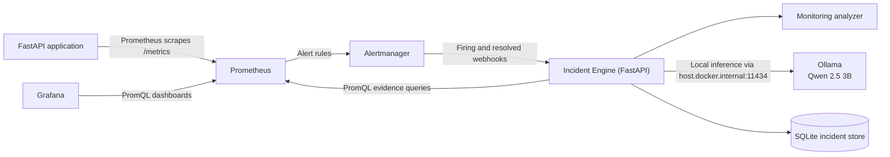

# SRE Observability & AIOps Platform

A local, production-inspired observability and incident-investigation platform. It combines a FastAPI service, Prometheus metrics and alerting, Grafana dashboards, Alertmanager routing, and a Python incident engine that uses a locally hosted Ollama model to assist with evidence-based investigations.

The project is intended as a learning and portfolio project for observability, SRE practices, incident lifecycle handling, and local AI integration. It is not a production-ready managed service.

## Capabilities

### Implemented

- FastAPI application with health, metrics, and controlled fault-injection endpoints.
- Request-count and request-duration metrics, labeled by HTTP method, route, and status code.
- Prometheus scraping and alert rules for application availability, HTTP 5xx ratio, and P95 latency.
- Alertmanager webhook delivery for firing and resolved alerts.
- Incident Engine that collects Prometheus evidence, analyzes service health, and stores incident records in SQLite.
- Fingerprint-based incident updates that preserve the original receipt time and investigation report.
- Retries when monitoring evidence is incomplete or AI output is invalid; duplicate firing notifications are suppressed after a successful investigation.
- Local Ollama investigation with Qwen 2.5 3B. The engine validates report content before considering an investigation successful.
- Incident history through a JSON API.
- Grafana application overview dashboard using Prometheus as its data source.

AI output is used to summarize evidence, form hypotheses, and recommend investigation steps. It does not execute remediation.

### Planned

- Investigation history and richer incident lifecycle tracking.
- Human-approved, initially simulated remediation workflows.
- Kubernetes deployment and Kubernetes-aware monitoring.
- AWS infrastructure and Terraform.
- CI/CD for tests, image builds, and deployment checks.

These are roadmap items, not currently implemented capabilities.

## Architecture



The incident flow is:

1. Prometheus scrapes the FastAPI application's `/metrics` endpoint.
2. Prometheus evaluates alert rules and forwards alerts to Alertmanager.
3. Alertmanager sends firing and resolved notifications to the Incident Engine.
4. For firing alerts, the engine queries Prometheus, analyzes the evidence, and invokes Ollama when the monitoring snapshot is complete.
5. The engine stores incident details and the investigation in SQLite. Repeated notifications update the incident record; successful investigations are reused rather than rerun.

## Technology

- Python 3.11, FastAPI, and SQLite
- Docker and Docker Compose
- Prometheus, Grafana, and Alertmanager
- Ollama with `qwen2.5:3b` for local inference

The Incident Engine reaches Ollama on the host through `http://host.docker.internal:11434/api/chat`. No paid external AI API is required for the project runtime.

## Prerequisites

- Docker Desktop with Linux containers (WSL2 is recommended on Windows).
- Docker Compose v2 (`docker compose`).
- Ollama installed and running on the host.
- The Qwen model pulled into Ollama:

  ```powershell
  ollama pull qwen2.5:3b
  ```

- Python 3.11 if you want to run the test suite on the host.

Start Ollama before testing AI-assisted incident processing. On Windows, `host.docker.internal` allows the container to reach the host's Ollama service.

## Run locally

From the repository root, start the Compose stack:

```powershell
docker compose up --build -d
```

Check service status and, if needed, inspect the Incident Engine logs:

```powershell
docker compose ps
docker compose logs --tail=100 incident-engine
```

Stop the services without removing persistent volumes:

```powershell
docker compose down
```

Prometheus data, Grafana data, and incident records are persisted using Docker volumes or the `incident-engine/data` bind mount. Do not use `docker compose down -v` if you want to retain that data.

## Service URLs

| Service | URL | Purpose |
| --- | --- | --- |
| FastAPI application | [http://localhost:8001](http://localhost:8001) | Monitored application |
| FastAPI interactive docs | [http://localhost:8001/docs](http://localhost:8001/docs) | OpenAPI interface |
| Application health | [http://localhost:8001/health](http://localhost:8001/health) | Application health response |
| Application metrics | [http://localhost:8001/metrics](http://localhost:8001/metrics) | Prometheus metrics |
| Prometheus | [http://localhost:9090](http://localhost:9090) | Metrics queries, targets, and alerts |
| Grafana | [http://localhost:3000](http://localhost:3000) | Application overview dashboard |
| Alertmanager | [http://localhost:9093](http://localhost:9093) | Alert routing and status |
| Incident Engine health | [http://localhost:8002/health](http://localhost:8002/health) | Engine and database health |
| Incident history | [http://localhost:8002/incidents](http://localhost:8002/incidents) | Stored incidents and investigations |
| Ollama on the host | [http://localhost:11434](http://localhost:11434) | Local model API used by the Incident Engine |

The Incident Engine webhook is `POST http://localhost:8002/webhook`; Alertmanager is configured to call it internally at `http://incident-engine:8002/webhook`.

## Fault injection and alerts

The application includes endpoints for exercising the alert pipeline:

- `GET /simulate-error` intentionally returns HTTP 500.
- `GET /simulate-delay?seconds=2` adds a delay; the `seconds` parameter is limited to 0–10.

Prometheus is configured to scrape every 5 seconds and evaluate rules every 5 seconds. The repository's alert rules include:

| Alert | Condition | Pending duration |
| --- | --- | --- |
| `ApplicationDown` | Prometheus reports the application target as down | 30 seconds |
| `HighErrorRate` | HTTP 5xx ratio is greater than 5% | 1 minute |
| `HighLatency` | P95 request latency is greater than 1 second | 1 minute |

Alert timing and detection depend on traffic and the configured Prometheus evaluation windows. For example, rate-based metrics need recent samples to produce useful evidence.

## Incident investigation and persistence

The Incident Engine enriches firing alerts with Prometheus metrics, endpoint-level evidence, findings, and recommendations. It then asks the local model for an investigation containing observed evidence, root-cause hypotheses, and recommended actions. A confirmed root cause remains unset unless supported by evidence.

The engine only treats a report as successful when monitoring is complete and the AI response passes structural and content validation. Incomplete evidence or invalid AI output can be retried on a later firing notification. Once a successful investigation exists for the same alert episode, duplicate firing notifications do not trigger another AI investigation.

SQLite is configured in Compose at `/data/incidents.db`, persisted through `./incident-engine/data:/data`. The incident API returns an `incident_count` and an `incidents` list.

## Grafana dashboard

The Grafana overview dashboard queries Prometheus at the internal Compose address `http://prometheus:9090`. Grafana's data is persisted in the `grafana_data` volume. Dashboard provisioning files are not currently included in this repository, so the dashboard is maintained in Grafana's persisted data rather than recreated from a checked-in dashboard definition.

## Validation and tests

Run the focused Incident Engine tests from PowerShell:

```powershell
py -3.11 -m venv .venv
.\.venv\Scripts\Activate.ps1
python -m pip install -r requirements.txt
python -m unittest tests.test_incident_webhook
python -m py_compile incident-engine\main.py tests\test_incident_webhook.py
```

The webhook tests cover investigation validation, incomplete-evidence retries, successful duplicate suppression, episode handling, and resolved notifications. They use mocked monitoring and AI functions; they do not require a live Ollama inference for those test cases.

## Project structure

```text
sre-aiops-platform/
├── app/
│   └── main.py                  # FastAPI app, fault injection, and metrics
├── alertmanager/
│   └── alertmanager.yml         # Webhook receiver and notification routing
├── grafana/                     # Grafana persistence is in a Compose volume
├── incident-engine/
│   ├── main.py                  # Incident API, lifecycle, and SQLite persistence
│   ├── analyzer.py              # Monitoring evidence analysis
│   ├── prometheus_api.py        # Prometheus query helpers
│   ├── ai_investigator.py       # Local Ollama investigation
│   ├── Dockerfile
│   └── data/                    # Host-mounted SQLite data directory
├── prometheus/
│   ├── prometheus.yml           # Scrape and Alertmanager configuration
│   └── alert-rules.yml          # Availability, error-rate, and latency rules
├── tests/
│   ├── __init__.py
│   └── test_incident_webhook.py # Incident and validator regression tests
├── Dockerfile                   # Monitored FastAPI app image
├── docker-compose.yml           # Local service orchestration
└── requirements.txt
```

## Roadmap

The next development areas are:

1. Improve monitoring data freshness/completeness signals and incident history.
2. Add further incident lifecycle and API validation.
3. Design a human approval workflow and start with harmless simulated remediation actions.
4. Explore Kubernetes deployment, probes, resource limits, and monitoring.
5. Add cost-conscious AWS infrastructure with Terraform.
6. Add CI/CD for automated tests, image builds, and deployment validation.

Kubernetes, AWS, Terraform, CI/CD, and remediation execution are not represented as implemented features of the current platform.
